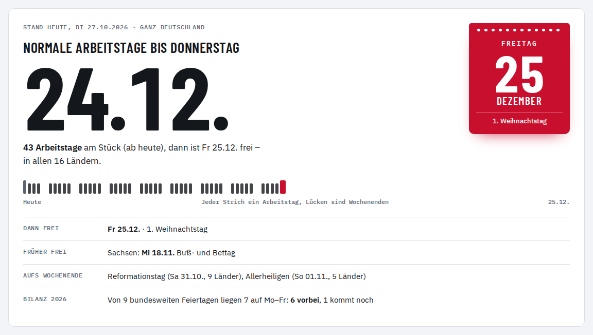

<p align="center"></p>

<h1 align="center">feiertagii</h1>

<p align="center"><b>Werktags-Feiertage</b> – welche gesetzlichen Feiertage fallen auf Montag bis Freitag,<br>
und wie lange ist es noch bis zum nächsten freien Werktag?<br>
Alle 16 Bundesländer, 1991 bis 2070, eine einzige statische Seite.</p>

<p align="center"><a href="https://bmmmm.github.io/feiertagii/"><b>→ bmmmm.github.io/feiertagii</b></a></p>

<picture>
  <source media="(prefers-color-scheme: dark)" srcset="docs/screenshot-dark.png">
  
</picture>

## Was die Seite zeigt

- **Feiertage Mo–Fr pro Jahr** – ein Liniendiagramm über alle Länder von 1991 bis 2070.
  Länder mit identischem Verlauf teilen sich eine Linie, Gesetzesänderungen sind als rote
  Punkte markiert, ab dem laufenden Jahr ist die Fläche als Prognose hinterlegt. Umschaltbar
  auf „aufs Wochenende gefallen“ und auf die Zeiträume 2000–2040 oder ±10 Jahre.
- **Ab heute** – bis wann nur normale Arbeitstage anstehen, der nächste freie Werktag als
  Abreißblatt und jeder Arbeitstag bis dahin als Strich. Für ganz Deutschland zusätzlich:
  welche Länder schon früher frei haben und was bis dahin aufs Wochenende fällt.
- **Länder im Vergleich** – Kachelkarte und Rangliste für das gewählte Jahr.
- **Jahresblatt** – zwölf Zeilen à 31 Tage, jeder Feiertag antippbar mit Details.
- **Alle Feiertage** – Matrix Feiertag × Land, wahlweise nur Mo–Fr.
- **Optional frei** – Rosenmontag, Heiligabend und Silvester sind keine gesetzlichen
  Feiertage, lassen sich aber für alle Länder als frei werten; alle Zahlen rechnen mit.

<picture>
  <source media="(prefers-color-scheme: dark)" srcset="docs/answer-dark.png">
  
</picture>

Alles wird im Browser berechnet: keine Cookies, kein Tracking, keine Anfragen an fremde
Server, die Schriften liegen im Repo. Gewähltes Land und optionale Tage bleiben im
`localStorage` des Browsers.

## So wird gerechnet

Die Termine kommen aus den Feiertagsgesetzen der Länder, Stand Oktober 2026:

- **Ostern** nach der gregorianischen Osterformel (Meeus/Jones/Butcher). Daran hängen
  Karfreitag, Ostermontag, Christi Himmelfahrt (+39 Tage), Pfingstmontag (+50) und
  Fronleichnam (+60).
- **Buß- und Bettag** ist der Mittwoch vor dem 23. November.
- **Regionale Feiertage** – Fronleichnam in Teilen Sachsens und Thüringens, Mariä
  Himmelfahrt in Teilen Bayerns, das Augsburger Friedensfest – werden angezeigt, zählen
  aber nicht in die Landessummen.
- **Ab 2027** ist alles eine Projektion nach heutiger Rechtslage.

Gesetzesänderungen seit 1991, die die Seite berücksichtigt:

| Jahr | Änderung |
|---|---|
| 1993 | Sachsen-Anhalt führt Heilige Drei Könige (6. Januar) ein |
| 1995 | Buß- und Bettag entfällt, außer in Sachsen |
| 2017 | Reformationstag einmalig bundesweit (500 Jahre Reformation) |
| 2018 | Reformationstag dauerhaft auch in Bremen, Hamburg, Niedersachsen und Schleswig-Holstein |
| 2019 | Internationaler Frauentag in Berlin, Weltkindertag in Thüringen |
| 2020, 2025 | Berlin: 8. Mai einmalig frei (Tag der Befreiung) |
| 2023 | Internationaler Frauentag in Mecklenburg-Vorpommern |

Maßgeblich ist das Bundesland des Arbeitsorts, nicht des Wohnorts.

Ein Feiertag fehlt, ein Datum stimmt nicht oder ein Land hat sein Gesetz geändert?
Bitte ein [Issue](https://github.com/bmmmm/feiertagii/issues) mit Quelle (Gesetz oder
Gesetzblatt) aufmachen.

## Lokal

`index.html` im Browser öffnen – kein Build, keine Abhängigkeiten.

```bash
scripts/build-site.sh _site    # stellt die veröffentlichte Seite zusammen
scripts/check-site.sh _site    # keine fremden Ressourcen, keine toten Verweise
```

Beides läuft auch in der CI, bevor GitHub Pages ausliefert.

| Datei | Inhalt |
|---|---|
| `index.html` | die ganze Seite: Styles, Feiertagsberechnung, Darstellung |
| `fonts/` | Barlow Condensed und IBM Plex (Latin-Subset, woff2) |
| `favicon.svg`, `og.png`, … | Icons und Vorschaubild; neu erzeugen mit `scripts/render-images.mjs` |
| `scripts/` | Build, Prüfung, Bildgenerator |

## Lizenz

[GPL-3.0-or-later](LICENSE). Die Schriften Barlow Condensed und IBM Plex stehen unter der
SIL Open Font License 1.1 ([`fonts/OFL-Barlow.txt`](fonts/OFL-Barlow.txt),
[`fonts/OFL-IBM-Plex.txt`](fonts/OFL-IBM-Plex.txt)).
