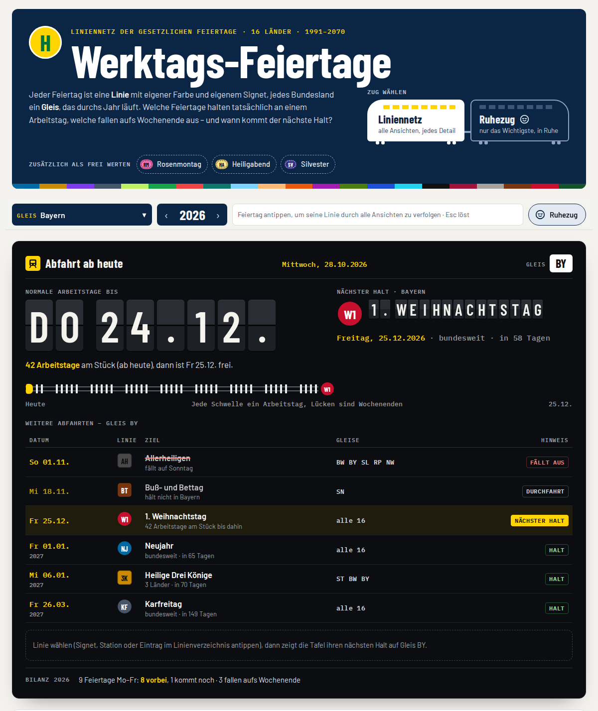
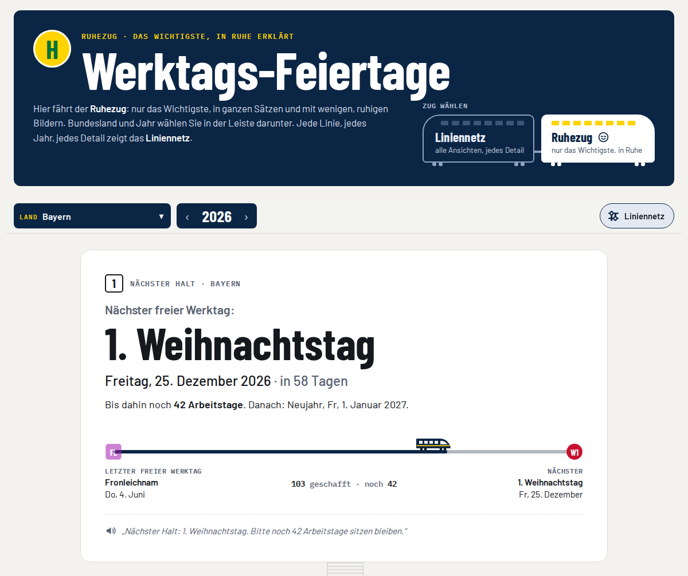
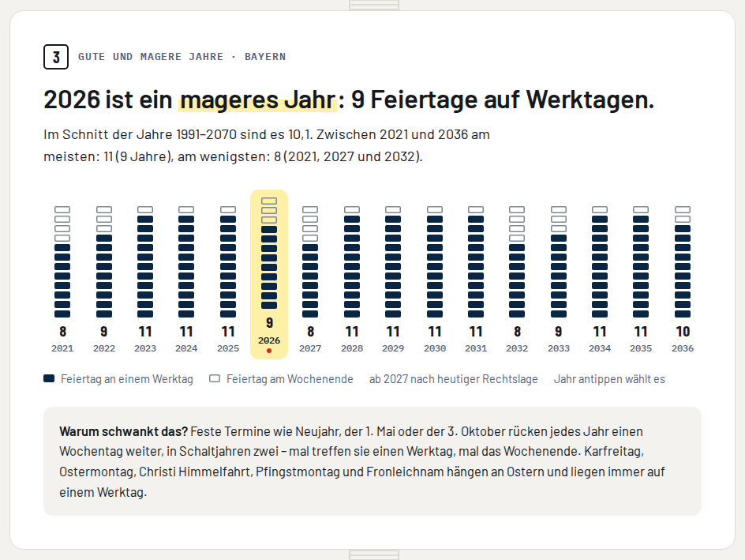
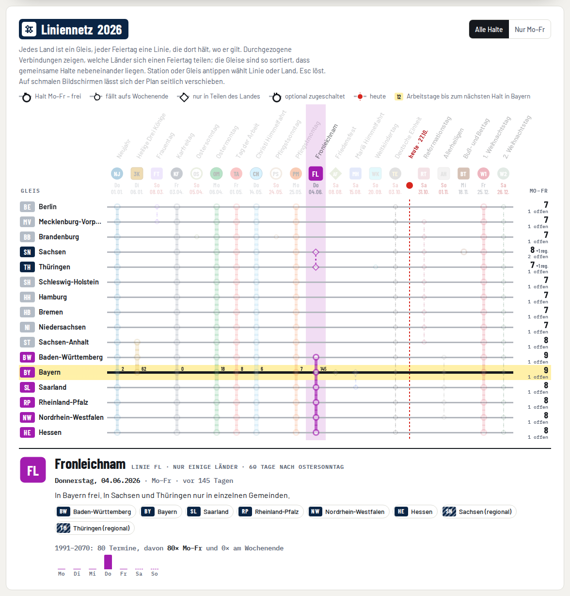
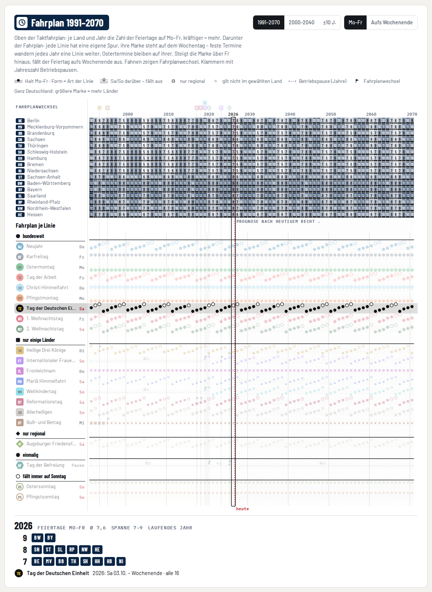

<p align="center"></p>

<h1 align="center">feiertagii</h1>

<p align="center"><b>Werktags-Feiertage</b> – welche gesetzlichen Feiertage fallen auf Montag bis Freitag,<br>
und wann kommt der nächste freie Werktag? Alle 16 Bundesländer, 1991 bis 2070,<br>
als Liniennetz: jeder Feiertag eine Linie, jedes Land ein Gleis.</p>

<p align="center"><a href="https://bmmmm.github.io/feiertagii/"><b>→ bmmmm.github.io/feiertagii</b></a></p>

<picture>
  <source media="(prefers-color-scheme: dark)" srcset="docs/screenshot-dark.png">
  
</picture>

## Zwei Züge: Liniennetz und Ruhezug

Oben im Kopf steht die **Zugwahl**, zwei gekuppelte Wagen. Das **Liniennetz** zeigt alles:
jede Linie, jedes Land, jedes Jahr, mit Vorschau quer durch alle Ansichten. Wem das zu viel
auf einmal ist, steigt in den **Ruhezug** um – auch mitten auf der Seite über den Knopf in der
Auswahlleiste. Er zeigt nur das Wichtigste: je Wagen eine Kernaussage in einem ganzen Satz und
ein ruhiges Bild, eine Farbe für Daten, Gelb für den nächsten Halt, Rot nur für „heute“.

1. **Nächster Halt** – der nächste freie Werktag, groß, mit Datum und Countdown. Darunter fährt
   ein Zug vom letzten freien Werktag bis heute: so viele Arbeitstage geschafft, so viele noch.
2. **Das Jahr** – wie viele Feiertage auf Mo–Fr fallen, wie viele aufs Wochenende, was schon
   vorbei ist; daneben der Reiseverlauf des Jahres mit einer Station je Feiertag.
3. **Gute und magere Jahre** – 16 Jahre als Stapel (volle Kästchen Mo–Fr, leere am Wochenende),
   der Vergleich mit dem Schnitt 1991–2070 und in zwei Sätzen, warum die Zahl schwankt.
4. **Die Länder im Vergleich** – jedes Land ein Zug, jeder Wagen ein Feiertag an einem Werktag.
5. **Gut zu wissen** – Arbeitsort zählt, regionale Tage zählen nicht; dazu die optionalen Tage.

Ein Link mit `#…&zug=ruhe` öffnet direkt den Ruhezug.

<picture>
  <source media="(prefers-color-scheme: dark)" srcset="docs/ruhe-dark.png">
  
</picture>

<picture>
  <source media="(prefers-color-scheme: dark)" srcset="docs/ruhe-jahre-dark.png">
  
</picture>

## Linien, Gleise, Halte

Jeder Feiertag hat ein eigenes **Signet**, das auf der ganzen Seite gleich aussieht:
die **Form** sagt, welche Art Feiertag es ist, **Farbe und Kürzel** sagen, welcher.

| Form | Art | Beispiele |
|---|---|---|
| Kreis | bundesweit | Neujahr `NJ`, Karfreitag `KF`, Tag der Deutschen Einheit `TE` |
| Quadrat | nur in einigen Ländern | Fronleichnam `FL`, Reformationstag `RT`, Frauentag `FT` |
| Raute | nur in Teilen eines Landes | Augsburger Friedensfest `AF` |
| Sechseck | einmalig | Tag der Befreiung `BF` (Berlin 2020 und 2025) |
| Ring | fällt immer auf einen Sonntag | Oster- und Pfingstsonntag in Brandenburg |
| gestrichelte Kapsel | optional, kein gesetzlicher Feiertag | Rosenmontag `RM`, Heiligabend `HA`, Silvester `SV` |

**Alles hängt zusammen.** Land, Jahr, Feiertag und Tag sind *eine* Auswahl, und jede
Ansicht folgt ihr: Mit dem Zeiger über ein Signet, eine Station oder eine Spur fahren
zeigt die Linie überall als Vorschau, ein Klick hält sie fest, `Esc` löst sie. Die
Auswahl steht in der Adresse (`#jahr=2026&land=BY&linie=fronleichnam`), ein Link teilt
also genau diese Ansicht.

- **Abfahrt ab heute** – eine Fallblatt-Tafel: bis wann nur normale Arbeitstage anstehen,
  der nächste Halt, jede Schwelle bis dahin ein Arbeitstag. Darunter die weiteren
  Abfahrten mit Hinweis: *Halt*, *fällt aus* (aufs Wochenende), *Durchfahrt* (gilt hier
  nicht), *Teilhalt* (nur regional), *früher frei* (anderswo eher).
- **Liniennetz** des Jahres – die 16 Länder als Gleise, die Feiertage als Linien, die dort
  halten, wo sie gelten. Man sieht sofort, welche Länder sich welchen Feiertag teilen; am
  gewählten Gleis stehen die Arbeitstage bis zum nächsten Halt. Der Steckbrief der
  gewählten Linie zeigt, auf welche Wochentage sie 1991–2070 fällt.
- **Jahresstrecke** – zwölf Monatsgleise, jede Schwelle ein Arbeitstag, Signets an den Halten.
- **Linienverzeichnis** – jeder Feiertag einzeln, mit Regel, Termin im gewählten Jahr und
  Gleisen; hier lassen sich auch die optionalen Tage zuschalten.
- **Fahrplan 1991–2070** – oben der Taktfahrplan (Land × Jahr, Zahl der Feiertage auf Mo–Fr
  oder aufs Wochenende), darunter eine Spur je Linie: die Höhe der Marke ist der
  Wochentag. Feste Termine wandern Jahr für Jahr eine Spur weiter, Ostertermine bleiben
  auf ihrer, Betriebspausen und Fahrplanwechsel zeigen die Gesetzesänderungen.
- **Gleise im Vergleich** – Kachelkarte und Rangliste der Länder für das gewählte Jahr.

<picture>
  <source media="(prefers-color-scheme: dark)" srcset="docs/netz-dark.png">
  
</picture>

<picture>
  <source media="(prefers-color-scheme: dark)" srcset="docs/fahrplan-dark.png">
  
</picture>

Alles wird im Browser berechnet: keine Cookies, kein Tracking, keine Anfragen an fremde
Server, die Schriften liegen im Repo. Gewähltes Land, optionale Tage und der gewählte Zug
bleiben im `localStorage` des Browsers. Bedienbar per Tastatur (Pfeiltasten im Fahrplan),
hell und dunkel, ab 360 px Breite.

## So wird gerechnet

Die Termine kommen aus den Feiertagsgesetzen der Länder, Stand Oktober 2026:

- **Ostern** nach der gregorianischen Osterformel (Meeus/Jones/Butcher). Daran hängen
  Karfreitag, Ostermontag, Christi Himmelfahrt (+39 Tage), Pfingstmontag (+50) und
  Fronleichnam (+60).
- **Buß- und Bettag** ist der Mittwoch vor dem 23. November.
- **Regionale Feiertage** – Fronleichnam in Teilen Sachsens und Thüringens, Mariä
  Himmelfahrt in Teilen Bayerns, das Augsburger Friedensfest – werden angezeigt, zählen
  aber nicht in die Landessummen.
- **Ab 2027** ist alles eine Projektion nach heutiger Rechtslage.

Gesetzesänderungen seit 1991, die die Seite berücksichtigt:

| Jahr | Änderung |
|---|---|
| 1993 | Sachsen-Anhalt führt Heilige Drei Könige (6. Januar) ein |
| 1995 | Buß- und Bettag entfällt, außer in Sachsen |
| 2017 | Reformationstag einmalig bundesweit (500 Jahre Reformation) |
| 2018 | Reformationstag dauerhaft auch in Bremen, Hamburg, Niedersachsen und Schleswig-Holstein |
| 2019 | Internationaler Frauentag in Berlin, Weltkindertag in Thüringen |
| 2020, 2025 | Berlin: 8. Mai einmalig frei (Tag der Befreiung) |
| 2023 | Internationaler Frauentag in Mecklenburg-Vorpommern |

Maßgeblich ist das Bundesland des Arbeitsorts, nicht des Wohnorts.

Ein Feiertag fehlt, ein Datum stimmt nicht oder ein Land hat sein Gesetz geändert?
Bitte ein [Issue](https://github.com/bmmmm/feiertagii/issues) mit Quelle (Gesetz oder
Gesetzblatt) aufmachen.

## Lokal

`index.html` im Browser öffnen – kein Build, keine Abhängigkeiten.

```bash
node tests/holidays.test.mjs   # Rechtslage gegen die Golden-Datei
scripts/build-site.sh _site    # stellt die veröffentlichte Seite zusammen
scripts/check-site.sh _site    # keine fremden Ressourcen, keine toten Verweise
```

Alle drei laufen auch in der CI, bevor GitHub Pages ausliefert.

| Datei | Inhalt |
|---|---|
| `index.html` | die ganze Seite: Styles, Rechtslage (`<script id="feiertage-daten">`), Darstellung |
| `fonts/` | Barlow, Barlow Condensed und IBM Plex Mono (Latin-Subset, woff2) |
| `favicon.svg`, `og.png`, … | Icons und Vorschaubild; neu erzeugen mit `scripts/render-images.mjs` |
| `scripts/`, `tests/` | Build, Prüfung, Bildgenerator, Golden-Test der Rechtslage |

## Lizenz

[GPL-3.0-or-later](LICENSE). Die Schriften Barlow, Barlow Condensed und IBM Plex Mono stehen unter der
SIL Open Font License 1.1 ([`fonts/OFL-Barlow.txt`](fonts/OFL-Barlow.txt),
[`fonts/OFL-IBM-Plex.txt`](fonts/OFL-IBM-Plex.txt)).
